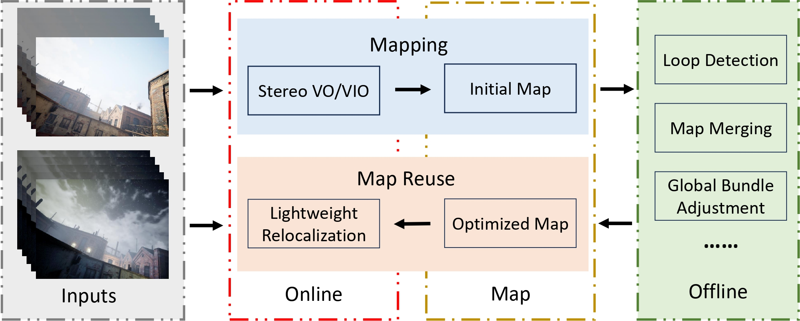

> **当前工作区（2026-10-27）**：已迁移至 TensorRT **11.3.0.99**、CUDA Toolkit **12.1** 和 ROS 2 Humble。
> 构建、EuRoC 回放、在线双目/IMU 输入与 S2M2/点云 BA 的当前操作说明，
> 见 [组合工作区说明](../airslam_recon_bringup/docs/BUILD_AND_RUN.md)。
> 下方 TensorRT 10.9 / CUDA 13.0 内容是原迁移记录，不应作为本工作区的安装步骤。
> 新增在线程序：stereo_inertial_node；结束并保存：/airslam/finish。
> 当前 TensorRT 11 基线保留 ONNX 图精度，不再使用已移除的自动 FP16 builder flag。

<h1 align="center">AirSLAM: An Efficient and Illumination-Robust Point-Line Visual SLAM System</h1>

<p align="center"><strong>
    <a href="https://scholar.google.com/citations?user=-p7HvCMAAAAJ&hl=zh-CN">Kuan Xu</a><sup>1</sup>,
    <a href="https://github.com/yuefanhao">Yuefan Hao</a><sup>2</sup>,
    <a href="https://scholar.google.com/citations?user=XcV_sesAAAAJ&hl=en">Shenghai Yuan</a><sup>1</sup>,
    <a href="https://sairlab.org/team/chenw/">Chen Wang</a><sup>2</sup>,
    <a href="https://scholar.google.com.sg/citations?user=Fmrv3J8AAAAJ&hl=en">Lihua Xie</a><sup>1</sup>
</strong></p>

<p align="center"><strong>
    <a href="https://www.ntu.edu.sg/cartin">1: CARTIN, Nanyang Technological University</a><br>
    <a href="https://sairlab.org/">2: SAIR Lab, University at Buffalo</a><br>
</strong></p>

<p align="center"><strong>
    <a href="https://arxiv.org/pdf/2408.03520">[PDF]</a> |
    <a href="https://xukuanhit.github.io/airslam/">[Project]</a> |
    <a href="https://youtu.be/5OcR5KeO5nc">[Youtube]</a>
</strong></p>

### Accepted to IEEE T-RO 2025

<p align="middle"></p>

**AirSLAM** is an efficient visual SLAM system combining deep learning frontend
(SuperPoint + PLNet + LightGlue/SuperGlue) with traditional backend optimization
(G2O). All neural networks are accelerated via **NVIDIA TensorRT** for real-time
inference.

> **This fork** migrates AirSLAM from ROS1 Noetic + TensorRT 8.x to
> **ROS2 Humble + TensorRT 10.9 + CUDA 13.0**. Full migration log: [docs/summary.md](docs/summary.md)

---

## Environment

| Component | ROS1 (original) | ROS2 Humble (this fork) |
|-----------|----------------|------------------------|
| OS | Ubuntu 20.04 | Ubuntu 22.04 |
| ROS | Noetic | **Humble** |
| Build | catkin | **colcon (ament_cmake)** |
| CUDA | 12.1 | **13.0** |
| TensorRT | 8.6.1.6 | **10.9.0.34** |
| G2O | Source build | **ros-humble-libg2o** |
| Launch | XML `<launch>` | **Python `LaunchDescription`** |
| ONNX | Original | **+ Int64→Int32 fix for TRT 10.9** |

---

## Quick Start

### 1. Install Dependencies

```bash
# System C++ libraries
sudo apt install -y build-essential cmake git wget unzip \
    libopencv-dev libeigen3-dev libyaml-cpp-dev \
    libboost-dev libboost-serialization-dev \
    libgflags-dev libgoogle-glog-dev libsuitesparse-dev python3-pip

# ROS2 Humble (see https://docs.ros.org/en/humble/Installation.html)
sudo apt install -y ros-humble-ros-base ros-humble-cv-bridge \
    ros-humble-tf2-ros ros-humble-visualization-msgs \
    ros-humble-libg2o ros-humble-desktop \
    python3-colcon-common-extensions python3-rosdep

# Python tools (for one-time ONNX fix)
pip3 install --user onnx onnxruntime onnx_graphsurgeon polygraphy
```

### 2. Place TensorRT 10.9

Download from [NVIDIA TensorRT](https://developer.nvidia.com/tensorrt/download) and extract:

```bash
mkdir -p ~/lib/Deploy
tar -xzf TensorRT-10.9.0.34.Linux.x86_64-gnu.cuda-13.0.tar.gz -C ~/lib/Deploy/
```

### 3. Build

```bash
mkdir -p ~/rosws/airslame_ws/src
cd ~/rosws/airslame_ws/src
git clone <this-fork-url> AirSLAM
git clone https://github.com/sair-lab/PLNet.git AirSLAM/3rdparty/PLNet

source /opt/ros/humble/setup.bash
cd ~/rosws/airslame_ws
colcon build --packages-select air_slam --cmake-args -DCMAKE_BUILD_TYPE=Release
```

### 4. Run

localization and mapping

```bash
source ~/rosws/airslame_ws/install/setup.bash
export LD_LIBRARY_PATH=~/lib/Deploy/TensorRT-10.9.0.34/lib:$LD_LIBRARY_PATH

ros2 launch air_slam vo_euroc.launch.py \
    dataroot:=/path/to/euroc/V1_01_easy/mav0 \
    saving_dir:=./output
```

map refinement
```bash
ros2 launch air_slam mr_euroc.launch.py \
map_root:=./output/ \
voc_path:=src/AirSLAM/voc/point_voc_L4.bin
```

relocalization
```bash
ros2 launch air_slam reloc_euroc.launch.py \
dataroot:=/home/ros/dataset/Euroc/vicon_room1/V1_02_medium/mav0/cam0/data \
map_root:=./output/ \
voc_path:=./src/AirSLAM/voc/point_voc_L4.bin
```

---

## Docker

### Build Image

```bash
cd AirSLAM
docker build -t airslam:ros2 .
```

### Run Container

```bash
docker run -it --gpus all --net=host --env DISPLAY=$DISPLAY \
    -v /tmp/.X11-unix:/tmp/.X11-unix \
    -v ~/datasets:/data \
    -v ~/lib/Deploy/TensorRT-10.9.0.34:/opt/tensorrt \
    airslam:ros2 /bin/bash
```

### Build + Run inside Container

```bash
# Inside container
source /opt/ros/humble/setup.bash
mkdir -p /workspace/src && cd /workspace/src
git clone <this-fork-url> AirSLAM
git clone https://github.com/sair-lab/PLNet.git AirSLAM/3rdparty/PLNet
cd /workspace
colcon build --packages-select air_slam --cmake-args -DCMAKE_BUILD_TYPE=Release
source install/setup.bash
ros2 launch air_slam vo_euroc.launch.py dataroot:=/data/euroc/V1_01_easy/mav0
```

---

## Download Datasets

### EuRoC MAV

```bash
mkdir -p ~/datasets/euroc/vicon_room1
cd ~/datasets/euroc

# V1_01_easy
wget http://robotics.ethz.ch/~asl-datasets/ijrr_euroc_mav_dataset/vicon_room1/V1_01_easy/V1_01_easy.zip
unzip V1_01_easy.zip -d vicon_room1/

# V1_02_medium
wget http://robotics.ethz.ch/~asl-datasets/ijrr_euroc_mav_dataset/vicon_room1/V1_02_medium/V1_02_medium.zip
unzip V1_02_medium.zip -d vicon_room1/

# More: http://robotics.ethz.ch/~asl-datasets/ijrr_euroc_mav_dataset/
```

### Other Datasets

| Dataset | Launch Config | Camera Config |
|---------|--------------|---------------|
| EuRoC | `vo_euroc.launch.py` | `configs/camera/euroc.yaml` |
| TUM-VI | `vo_tartanair.launch.py` | `configs/camera/tartanair.yaml` |
| OIVIO | `vo_oivio.launch.py` | `configs/camera/oivio.yaml` |
| UMA Bumblebee | `vo_uma_bumblebee.launch.py` | `configs/camera/uma_bumblebee.yaml` |

---

## Run Commands

### Visual Odometry (Mapping)

```bash
source /opt/ros/humble/setup.bash
source ~/rosws/airslame_ws/install/setup.bash
export LD_LIBRARY_PATH=~/lib/Deploy/TensorRT-10.9.0.34/lib:$LD_LIBRARY_PATH

# Via launch
ros2 launch air_slam vo_euroc.launch.py \
    dataroot:=~/datasets/euroc/vicon_room1/V1_01_easy/mav0

# Via direct node (debugging)
ros2 run air_slam visual_odometry --ros-args \
  -p config_path:=install/air_slam/share/air_slam/configs/visual_odometry/vo_euroc.yaml \
  -p dataroot:=~/datasets/euroc/vicon_room1/V1_01_easy/mav0 \
  -p camera_config_path:=install/air_slam/share/air_slam/configs/camera/euroc.yaml \
  -p model_dir:=install/air_slam/share/air_slam/output \
  -p saving_dir:=/tmp/airslam_debug
```

### Map Refinement

```bash
ros2 launch air_slam mr_euroc.launch.py map_root:=/path/to/map
```

### Relocalization

```bash
ros2 launch air_slam reloc_euroc.launch.py \
    dataroot:=/path/to/query/images map_root:=/path/to/map
```

### Launch Parameters

| Parameter | Default | Description |
|-----------|---------|-------------|
| `dataroot` | (required) | Dataset path, **must include `mav0/`** for EuRoC |
| `config_path` | `.../vo_euroc.yaml` | YAML config file |
| `camera_config_path` | `.../euroc.yaml` | Camera intrinsics + IMU |
| `model_dir` | `.../output` | ONNX + cached engines |
| `saving_dir` | `.../debug` | Trajectory output |
| `visualization` | `true` | Launch RViz2 |

---

## Dataset Format

Data must follow ASL/EuRoC format. **dataroot must point to the directory containing `cam0/`, `cam1/`, `imu0/`** (i.e., include `mav0/` for EuRoC):

```
dataroot/                    ← e.g. .../V1_01_easy/mav0/
├── cam0/data/*.png         ← Left camera (752x480 for EuRoC)
├── cam1/data/*.png         ← Right camera
├── imu0/data.csv           ← IMU (timestamp,gx,gy,gz,ax,ay,az), optional
└── state_groundtruth_estimate0/  ← Ground truth (optional)
```

---

## Model Weights

Pre-trained ONNX models are included in `output/`:

| File | Size | Model |
|------|------|-------|
| `output/superpoint_v1_sim_int32.onnx` | 5.0 MB | SuperPoint keypoint detector |
| `output/superpoint_lightglue.onnx` | 44 MB | LightGlue feature matcher |
| `output/plnet_s0.onnx` | 32 MB | PLNet Stage 0 (junction detection) |
| `output/plnet_s1.onnx` | 1.8 MB | PLNet Stage 1 (line features) |

**First run**: TensorRT compiles ONNX → `.engine` (2-5 min/model, ~91 MB total).  
**Subsequent runs**: engines load from cache in milliseconds.

### TRT 10.9 ONNX Fix

SuperPoint ONNX has Int64/Int32 type issues with TRT 10.9 strict parser.
Run this once before first build or use the pre-fixed models:

```bash
python3 scripts/fix_superpoint_onnx.py
```

Full details: [docs/summary.md](docs/summary.md#4-onnx-模型兼容性修复).

---

## Performance

EuRoC V1_01_easy on RTX GPU:

| Stage | Time |
|-------|------|
| Engine cache loading | <1s |
| Per-frame (init, frames 0-4) | ~2ms |
| IMU initialization (frame 5) | ~430ms |
| Keyframe insertion (frame 6) | ~30ms |
| **Per-frame steady-state** | **2-7ms** |

Steady-state: **140-500 FPS** equivalent (I/O bound by dataset reading).

---

## Build Options

```bash
# Release
colcon build --packages-select air_slam --cmake-args -DCMAKE_BUILD_TYPE=Release

# Debug
colcon build --packages-select air_slam --cmake-args -DCMAKE_BUILD_TYPE=Debug

# Full rebuild after CMakeLists.txt changes
colcon build --packages-select air_slam --cmake-clean-first
```

---

## Troubleshooting

| Symptom | Solution |
|---------|----------|
| `libnvinfer.so.10: cannot open shared object file` | `export LD_LIBRARY_PATH=~/lib/Deploy/TensorRT-10.9.0.34/lib:$LD_LIBRARY_PATH` |
| `SuperPoint building failed` / TRT engine build error | Run `scripts/fix_superpoint_onnx.py`, delete old `*.engine`, rebuild |
| `dataroot ... doesn't exist` | Include `mav0/` in path: `dataroot:=.../V1_01_easy/mav0` |
| `cv_bridge/cv_bridge.h: No such file` | `sudo apt install ros-humble-cv-bridge` |
| `malloc(): unaligned tcache chunk` | Delete cached `.engine` files, let C++ rebuild from ONNX |
| `Config file ... doesn't exist` | Rebuild with `--cmake-clean-first` |
| RViz opens but no mapping output | Check terminal for errors; run with `ros2 run` directly to see output |
| `G2O_INCLUDE_DIR` CMake error | Uses `find_package(g2o)` (lowercase) — install `ros-humble-libg2o` |
| `-lcudart` not found | CUDA 13.0 needs `link_directories(${CUDA_TOOLKIT_ROOT_DIR}/lib64)` |

---

## Project Structure

```
AirSLAM/
├── CMakeLists.txt          # Build config (ament_cmake)
├── package.xml             # ROS2 package manifest (format 3)
├── Dockerfile              # Docker build with TRT 10.9
├── README.md               # This file
├── docs/summary.md         # Full migration summary
├── configs/                # YAML configuration files
│   ├── camera/             # Camera intrinsics + IMU params
│   ├── visual_odometry/    # VO/VIO configs
│   ├── map_refinement/     # Map refinement configs
│   └── relocalization/     # Relocalization configs
├── launch/                 # ROS2 Python launch files
├── include/                # C++ headers
├── src/                    # C++ source
├── demo/                   # Entry points
├── output/                 # ONNX models + TensorRT engines
├── scripts/                # Python utilities
├── 3rdparty/
│   ├── DBoW2/              # Bag-of-Words
│   ├── tensorrtbuffer/     # TRT buffer manager (TRT 10.x)
│   └── PLNet/              # PLNet training code + weights
└── figures/                # Documentation images
```

---

## Citation

```bibtex
@article{xu2024airslam,
  title = {{AirSLAM}: An Efficient and Illumination-Robust Point-Line Visual SLAM System},
  author = {Xu, Kuan and Hao, Yuefan and Yuan, Shenghai and Wang, Chen and Xie, Lihua},
  journal = {IEEE Transactions on Robotics (TRO)},
  year = {2024},
  url = {https://arxiv.org/abs/2408.03520},
}
```
