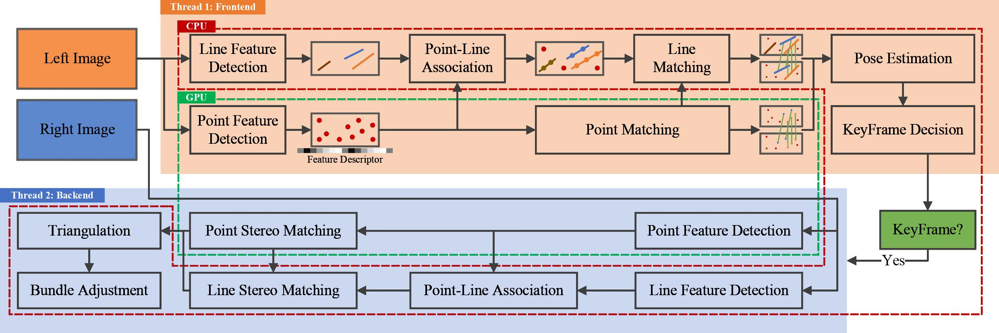
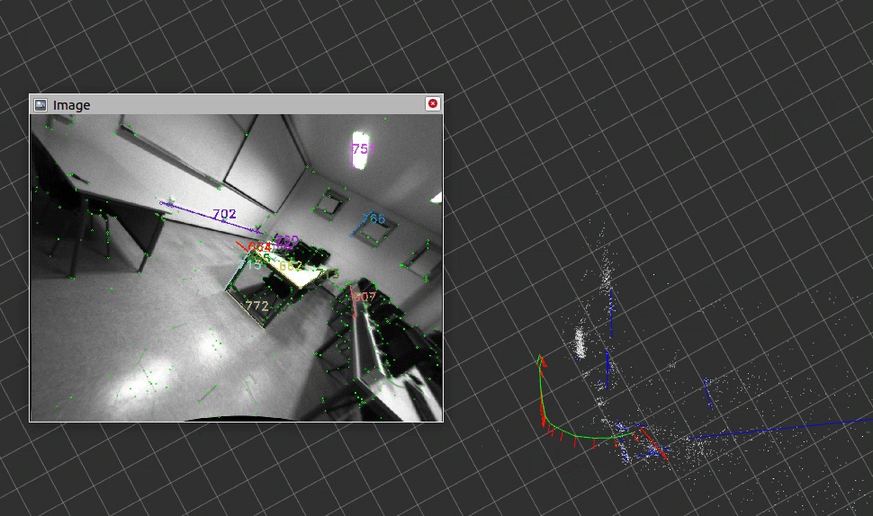
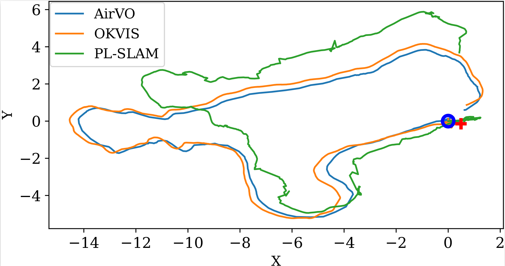
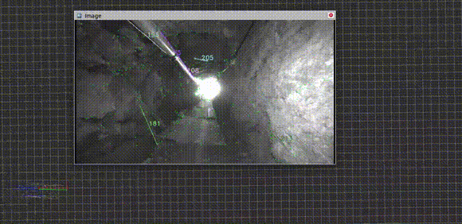
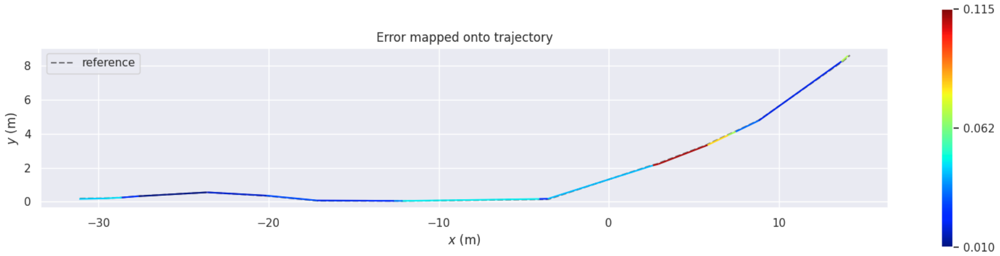
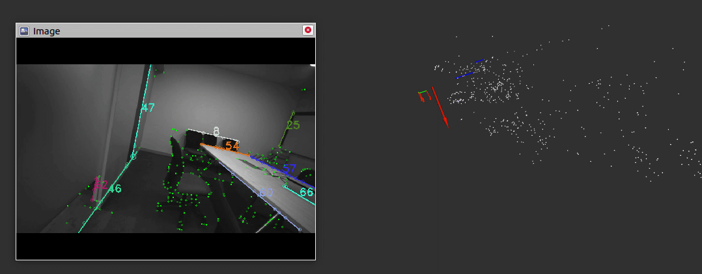
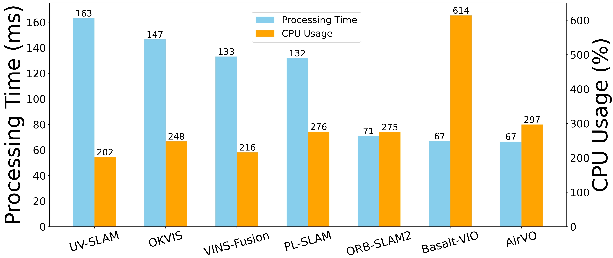

# AirVO
## An Illumination-Robust Point-Line Visual Odometry

> **ROS 2 port (this directory)**: migrated from ROS 1 Noetic + TensorRT 8.4 to
> **ROS 2 Humble + TensorRT 10.9 + CUDA 13.0**, matching the
> [`AirSLAM_ROS2`](../AirSLAM_ROS2) fork. Details: [docs/migration.md](docs/migration.md).
> The original ROS 1 package is kept in [`../AirVO`](../AirVO).

 

AirVO is an **illumination-robust** and accurate **stereo visual odometry (VO) system** based on **point and line features**. It is a hybrid VO system that combines the efficiency of traditional optimization techniques with the robustness of learning-based methods. To be robust to illumination variation, we introduce both the **learning-based feature extraction ([SuperPoint](https://github.com/magicleap/SuperPointPretrainedNetwork))** and **matching ([SuperGlue](https://github.com/magicleap/SuperGluePretrainedNetwork)) method** to the system. Moreover, We propose a new line processing pipeline for VO that **associates 2D lines with learning-based 2D points** on the image, leading to more robust feature matching and triangulation. This novel method enhances the accuracy and reliability of VO, especially in illumination-challenging environments. By accelerating CNN and GNN parts using Nvidia TensorRT Toolkit, our point feature detection and matching achieve more than **5× faster** than the original codes. The system can run at a rate of about **15Hz** on the Nvidia Jetson AGX Xavier (a low-power embedded device) and **40Hz** on a notebook PC.

**Authors:** [Kuan Xu](https://github.com/xukuanHIT), [Yuefan Hao](https://github.com/yuefanhao), [Shenghai Yuan](https://scholar.google.com/citations?user=XcV_sesAAAAJ&hl=en), [Chen Wang](https://chenwang.site/), and [Lihua Xie](https://personal.ntu.edu.sg/elhxie/)


## Related Papers

**AirVO: An Illumination-Robust Point-Line Visual Odometry**, Kuan Xu, Yuefan Hao, Shenghai Yuan, Chen Wang and Lihua Xie, *IEEE/RSJ International Conference on Intelligent Robots and Systems (IROS)*, 2023. **[PDF](https://arxiv.org/abs/2212.07595)**.

If you use AirVO, please cite:

```bibtex
@inproceedings{xu2023airvo,
  title={AirVO: An Illumination-Robust Point-Line Visual Odometry},
  author={Xu, Kuan and Hao, Yuefan and Yuan, Shenghai and Wang, Chen and Xie, Lihua},
  booktitle={IEEE/RSJ International Conference on Intelligent Robots and Systems (IROS)},
  year={2023}
}
```


## ROS 2 Build & Run

Target stack (same as `AirSLAM_ROS2`): Ubuntu 22.04, ROS 2 Humble, CUDA 13.0,
TensorRT 10.9.0.34, OpenCV 4.2+, `ros-humble-libg2o`.
The port also builds and runs against TensorRT 11.x (see
[Version notes](#version-notes)); `docs/migration.md` has the full change log.

### Dependencies

```bash
sudo apt install -y libopencv-dev libeigen3-dev libyaml-cpp-dev \
    libboost-serialization-dev libgflags-dev libgoogle-glog-dev
sudo apt install -y ros-humble-ros-base ros-humble-cv-bridge \
    ros-humble-message-filters ros-humble-libg2o ros-humble-rviz2
```

TensorRT 10.9 is expected at `$HOME/lib/Deploy/TensorRT-10.9.0.34`
(the same path used by `AirSLAM_ROS2`). Override it at configure time with
`-DTENSORRT_DIR=...` if your installation lives elsewhere.

### Build

```bash
source /opt/ros/humble/setup.bash
cd ~/rosws/airslam_ws

# TensorRT 10.9 (default path)
colcon build --packages-select air_vo --cmake-args -DCMAKE_BUILD_TYPE=Release

# or point at a different TensorRT installation
colcon build --packages-select air_vo --cmake-args \
    -DCMAKE_BUILD_TYPE=Release -DTENSORRT_DIR=$HOME/lib/TensorRT-11.3.0.99

source install/setup.bash
export LD_LIBRARY_PATH=$HOME/lib/Deploy/TensorRT-10.9.0.34/lib:$LD_LIBRARY_PATH
```

### Executables

| Executable | Purpose |
|---|---|
| `air_vo` | Offline VO from an ASL-format dataset directory |
| `air_vo_ros` | Live VO from two synchronized image topics |
| `test_feature` | SuperPoint/SuperGlue self-check on one or two images |

### Run offline (dataset)

`dataroot` must contain `cam0/data/*` and `cam1/data/*` (for EuRoC, point it at
the `mav0` directory). `saving_dir` must already exist — it is not created
automatically.

```bash
mkdir -p /tmp/airvo_out
ros2 launch air_vo euroc.launch.py \
    dataroot:=/path/to/EuRoC/V1_01_easy/mav0 \
    saving_dir:=/tmp/airvo_out \
    traj_path:=/tmp/airvo_out/traj.txt
```

Trajectory is written in TUM format (`timestamp tx ty tz qx qy qz qw`) when the
process exits.

### Run live (ROS 2 bag / stereo topics)

Terminal 1 — start the node:

```bash
mkdir -p /tmp/airvo_out
ros2 launch air_vo euroc_ros.launch.py \
    left_topic:=/cam0/image_raw right_topic:=/cam1/image_raw \
    saving_dir:=/tmp/airvo_out traj_path:=/tmp/airvo_out/traj.txt
```

> The first launch builds the TensorRT engines **before** creating the
> subscriptions (a few minutes per model), so the node can look idle and no
> topics appear in `ros2 node info` yet. Wait until it is ready:

```bash
ros2 node info /air_vo_ros | sed -n '/Subscribers/,/Publishers/p'
#   /cam0/image_raw: sensor_msgs/msg/Image
#   /cam1/image_raw: sensor_msgs/msg/Image
```

Terminal 2 — play the bag (start it **after** the subscriptions exist; frames
published earlier are dropped):

```bash
ros2 bag play /path/to/euroc_bag --topics /cam0/image_raw /cam1/image_raw
```

Check the output:

```bash
ros2 topic hz /cam0/image_raw     # bag rate, ~20 Hz for EuRoC
ros2 topic hz /AirVO/frame_pose   # VO output rate
ros2 topic echo --once /AirVO/frame_pose
```

The live node subscribes with `rmw_qos_profile_sensor_data` (BEST_EFFORT),
which is compatible with the RELIABLE publishers used by `ros2 bag play` and
most camera drivers.

### Published topics

| Topic | Type | Content |
|---|---|---|
| `/AirVO/feature` | `sensor_msgs/msg/Image` | Features and tracked lines overlay |
| `/AirVO/frame_pose` | `geometry_msgs/msg/PoseStamped` | Current frame pose |
| `/AirVO/keyframe` | `geometry_msgs/msg/PoseArray` | Keyframe poses |
| `/AirVO/odometry` | `nav_msgs/msg/Path` | Keyframe trajectory |
| `/AirVO/map` | `sensor_msgs/msg/PointCloud` | Map points |
| `/AirVO/mapline` | `visualization_msgs/msg/Marker` | Map lines |

RViz2 is started by the launch files (`visualization:=false` disables it) and
loads `share/air_vo/rviz/airvo.rviz`.

### Engine cache and model directory

- ONNX models live in `output/` and are installed to
  `install/air_vo/share/air_vo/output/`.
- On first run each ONNX is compiled into a `.engine` file **next to it**
  (SuperPoint a few MB, SuperGlue ~60 MB). Later runs load the cache in
  milliseconds.
- The default `model_dir` is inside `install/`, so `--cmake-clean-first` or
  deleting `install/` discards the engines. For a persistent cache, copy the
  ONNX files to a writable directory and pass `model_dir:=/path/to/models`.

### Self-check

```bash
ros2 run air_vo test_feature --ros-args \
    -p config_path:=install/air_vo/share/air_vo/configs/configs_euroc.yaml \
    -p model_dir:=install/air_vo/share/air_vo/output \
    -p image0:=/path/to/image.png
# image0 features = 400
# matches = 372
# diagonal matches = 365   (image1 omitted -> identical features)
```

### Version notes

- **TensorRT 10.9**: FP16 is enabled (same behaviour as `AirSLAM_ROS2`).
- **TensorRT 11.x**: `BuilderFlag::kFP16` was removed, so engines are built in
  FP32/TF32. On an RTX 4060 Ti this measured ~10 FPS at 400 keypoints, while
  EuRoC bags arrive at ~20 Hz; the input queue (depth 3) drops frames when the
  pipeline cannot keep up. Functional results are unaffected.
- Shipped ONNX models are normalized for strict TensorRT type checking
  (`scripts/fix_onnx_shape_dtype.py`); the SuperPoint model uses the
  cast-fixed graph from `AirSLAM_ROS2` (same network weights).

### Known limitations

- No automated tests; accuracy must be checked with `evo` on a dataset with
  ground truth (the EuRoC ROS 2 bag only has `/vicon/firefly_sbx/firefly_sbx`,
  which can be converted to TUM).
- The live node builds engines before subscribing, so bag playback should be
  started after the node is ready.
- Default `dataroot` values in the launch files are upstream examples; always
  pass a real path.

## Demos

### UMA-VI dataset
[UMA-VI dataset](http://mapir.isa.uma.es/mapirwebsite/?p=2108) contains many sequences where images may suddenly darken as a result of turning off the lights. Here are demos on two sequences.



### OIVIO dataset
[OIVIO dataset](https://arpg.github.io/oivio/) collects data in mines and tunnels with onboard illumination.

 


### Live demo with realsense camera
We also test AirVO on sequences collected by Realsense D435I in the environment with continuous changing illumination. 



### More
[Video demo](https://www.youtube.com/watch?v=ZBggy5syysY)


## Efficiency Comparison
The evaluation is performed on the Nvidia Jetson AGX Xavier (2018), a low-power embedded platform with an 8-core ARM v8.2 64-bit CPU and a lowpower 512-core NVIDIA Volta GPU. The resolution of the input image sequence is 640 × 480. We extract 200 points and disabled the loop closure, relocalization and visualization part for all algorithms.




## Test Environment
### Dependencies
* OpenCV 4.2
* Eigen 3
* Ceres 2.0.0 
* G2O (tag:20230223_git)
* TensorRT 8.4 
* CUDA 11.6
* python
* onnx
* ROS noetic
* Boost
* Glog

For **Nvidia GeForce RTX 40 series**, please use TensorRT 8.5 and CUDA 11.8 instead.

### Docker (Recommend)
```bash
docker pull xukuanhit/air_slam:v1
docker run -it --env DISPLAY=$DISPLAY --volume /tmp/.X11-unix:/tmp/.X11-unix --privileged --runtime nvidia --gpus all --volume ${PWD}:/workspace --workdir /workspace --name air_slam xukuanhit/air_slam:v1 /bin/bash
```

For **Nvidia GeForce RTX 40 series**:
```bash
docker pull xukuanhit/air_slam:v3
docker run -it --env DISPLAY=$DISPLAY --volume /tmp/.X11-unix:/tmp/.X11-unix --privileged --runtime nvidia --gpus all --volume ${PWD}:/workspace --workdir /workspace --name air_slam xukuanhit/air_slam:v3 /bin/bash
```

## Data
The data should be organized using the Automous Systems Lab (ASL) dataset format just like the following:

```
dataroot
├── cam0
│   └── data
│       ├── 00001.jpg
│       ├── 00002.jpg
│       ├── 00003.jpg
│       └── ......
└── cam1
    └── data
        ├── 00001.jpg
        ├── 00002.jpg
        ├── 00003.jpg
        └── ......
```

## Build
```
    cd ~/catkin_ws/src
    git clone https://github.com/xukuanHIT/AirVO.git
    cd ../
    catkin_make
    source ~/catkin_ws/devel/setup.bash
```

## Run 

**Note: Generating ".engine" files needs some time on the first run.**

### [OIVIO Dataset](https://arpg.github.io/oivio/)
```
roslaunch air_vo oivio.launch 
```

### [UMA-VI Dataset](http://mapir.isa.uma.es/mapirwebsite/?p=2108)
```
roslaunch air_vo uma_bumblebee_indoor.launch 
```

### [Euroc Dataset](https://projects.asl.ethz.ch/datasets/doku.php?id=kmavvisualinertialdatasets)
```
roslaunch air_vo euroc.launch 
```

## Acknowledgements
We would like to thank [SuperPoint](https://github.com/magicleap/SuperPointPretrainedNetwork) and [SuperGlue](https://github.com/magicleap/SuperGluePretrainedNetwork) for making their project public.
